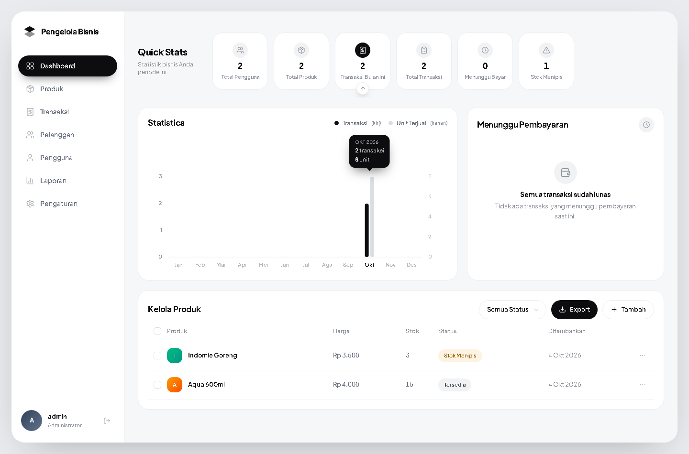
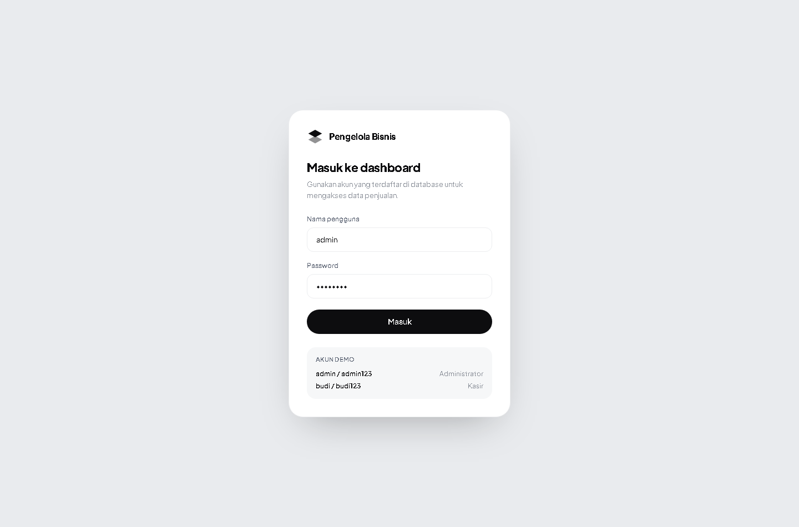
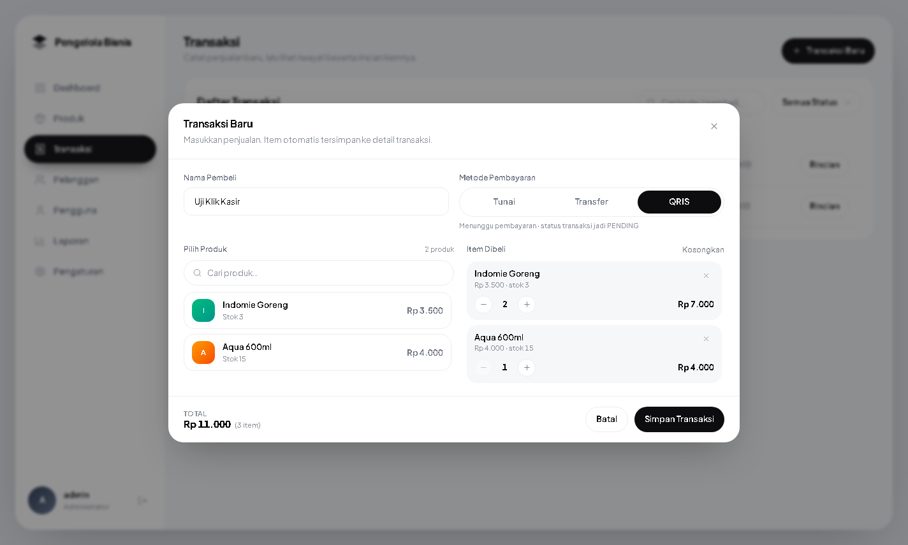

# Frontend — App Pengelola Bisnis

Dashboard React + Vite + Tailwind CSS yang **terhubung langsung** ke backend
Express/MySQL yang sudah ada di folder `../Backend`. Desainnya mengikuti gambar
referensi (dashboard Jobbio), dengan istilah yang disesuaikan ke domain
aplikasi ini: produk, transaksi, pengguna.


> Tangkapan layar di atas diambil dengan **data demo** terpasang
> (`node seedDemo.js`), supaya seluruh komponen terlihat terisi.

Dengan data asli saja — panel "Menunggu Pembayaran" menampilkan keadaan kosong
dan lencana di sidebar otomatis hilang:



Halaman masuk:



---

## 1. Cara menjalankan

Butuh dua proses: backend dan frontend.

```bash
# Terminal 1 — backend (Express + MySQL) di http://localhost:3000
cd Backend
npm install
npm start

# Terminal 2 — frontend (Vite) di http://localhost:5173
cd Frontend
npm install
npm run dev
```

Buka **http://localhost:5173** lalu masuk dengan akun dari database:

| Nama  | Password   | Peran         | Bisa apa saja                                        |
|-------|------------|---------------|------------------------------------------------------|
| admin | admin123   | Administrator | Semua, termasuk tambah/ubah/hapus produk & lihat pengguna |
| budi  | budi123    | Kasir         | Lihat produk, transaksi, pelanggan, laporan          |

Database harus sudah diisi lebih dulu: jalankan `database/schema.sql` lalu
`database/seed.sql` (lihat `database/README.md`).

---

## 2. Kenapa tidak ada masalah CORS

Backend **tidak** memakai paket `cors`. Karena itu semua permintaan `/api`
diteruskan (proxy) oleh dev server Vite ke `http://localhost:3000`
(lihat `vite.config.js`). Browser melihat satu origin saja, jadi tidak ada
preflight yang gagal dan backend tidak perlu diubah.

Untuk produksi, set `VITE_API_BASE` ke URL API yang sebenarnya:

```bash
VITE_API_BASE=https://api.contoh.com/api npm run build
```

---

## 3. Autentikasi

Backend melindungi hampir semua endpoint dengan JWT (`authMiddleware`), jadi
alur login di frontend bukan hiasan:

1. `POST /api/auth/login` → `{ token, user }`
2. Token disimpan di `localStorage` (`pb.sesi.v1`).
3. Klien API (`src/api/client.js`) menempelkan `Authorization: Bearer <token>`
   pada setiap permintaan.
4. Respons **401** otomatis memicu logout + pesan "sesi berakhir".
5. Token backend berlaku 1 jam.

Jembatan token dipasang di **level modul** (`src/auth/AuthContext.jsx`), bukan di
dalam `useEffect`. Alasannya: `useEffect` berjalan dari anak ke induk, sehingga
halaman anak yang fetch saat mount akan berjalan lebih dulu dan token belum
terpasang.

---

## 4. Endpoint backend yang dipakai

| Metode | Endpoint | Dipakai di |
|--------|----------|-----------|
| POST   | `/api/auth/login` | Halaman masuk |
| GET    | `/api/dashboard/ringkasan` | Dashboard, Laporan, uji koneksi |
| GET    | `/api/produk` | Tabel produk (dashboard + halaman Produk) |
| POST   | `/api/produk` | Tambah produk (admin) |
| PUT    | `/api/produk/:id` | Ubah produk (admin) |
| DELETE | `/api/produk/:id` | Hapus produk — *soft delete* (admin) |
| GET    | `/api/transaksi` | Halaman Transaksi, lencana sidebar |
| GET    | `/api/transaksi/:id` | Modal rincian item |
| PATCH  | `/api/transaksi/:id/batal` | Tombol "Batalkan Transaksi" |
| GET    | `/api/users` | Halaman Pengguna (admin) |

### Alur penjualan (layar kasir)



Ada di halaman **Transaksi** lewat tombol **Transaksi Baru**, atau langsung
dengan membuka `#/transaksi?baru=1` (bisa di-bookmark kasir).

Yang terjadi saat tombol **Simpan Transaksi** ditekan — semuanya ditangani
backend, frontend tidak menghitung apa pun sendiri:

1. `POST /api/transaksi` dengan `{ nama_pembeli, metode_pembayaran, produk[] }`
2. Backend membuat **1 baris di `transaksi`** → dapat `id` dan `kode_transaksi`
3. Backend menulis **semua item ke `detail_transaksi`** dengan `transaksi_id`
   dari langkah 2
4. Backend mengurangi stok produk

Keempatnya berada dalam **satu transaksi database**, jadi kalau ada satu langkah
gagal (misalnya stok kurang), tidak ada yang tersimpan separuh.

Catatan penting:

- Total yang tampil di layar hanya untuk dilihat kasir. Angka yang benar-benar
  disimpan selalu dihitung ulang backend dari harga di database.
- `produk_id` dan `jumlah` wajib bilangan bulat — backend memakai
  `Number.isInteger()` dan tidak melakukan konversi otomatis.
- Metode **QRIS** membuat status transaksi `PENDING` (menunggu pembayaran);
  **CASH** dan **TRANSFER** langsung `PAID`. Aturan ini ada di backend.
- Setelah tersimpan, rincian transaksi langsung dibuka supaya item yang masuk
  ke `detail_transaksi` bisa langsung diperiksa.
- Jumlah per produk dibatasi stok di sisi klien, tetapi backend tetap
  memvalidasi ulang dengan row lock — jadi dua kasir yang menjual bersamaan
  tidak bisa membuat stok jadi minus.

### Membatalkan transaksi

Tombol **Batalkan Transaksi** ada di dalam modal **Rincian Transaksi**, jadi
kasir melihat dulu barang apa saja yang terjual sebelum membatalkan. Karena
rincian otomatis terbuka setelah penjualan tersimpan, salah input bisa langsung
dibatalkan tanpa mencari barisnya di tabel.

Yang dilakukan backend saat pembatalan:

1. Mengunci baris `transaksi` dengan `SELECT ... FOR UPDATE`
2. Menolak kalau statusnya sudah `CANCELLED`
3. Mengembalikan stok tiap produk sebanyak yang terjual
4. Mengubah status menjadi `CANCELLED`

Barisnya **tidak dihapus** — `detail_transaksi` tetap ada supaya riwayat
penjualan bisa ditelusuri.

Penguncian di langkah 1 penting: tanpa itu, dua permintaan pembatalan yang
datang bersamaan bisa sama-sama lolos pemeriksaan lalu mengembalikan stok dua
kali. Perilaku ini sudah diuji — pembatalan kedua ditolak dengan pesan
"Transaksi ini sudah dibatalkan sebelumnya" dan stok tidak bertambah lagi.

### Endpoint yang ditambahkan ke backend

Tiga endpoint baru dibuat karena dashboard memang butuh data agregat yang
sebelumnya belum tersedia. Semuanya **aditif** — tidak ada kontrak lama yang
diubah:

- `GET /api/dashboard/ringkasan` → statistik, grafik 12 bulan, transaksi pending
- `GET /api/transaksi` → daftar transaksi + filter status + paginasi
- `GET /api/users` → daftar pengguna (tanpa kolom password)

Ditambah dua perubahan kecil yang tetap kompatibel:

- `GET /api/produk` menerima `?status=` (tersedia / menipis / habis / nonaktif)
  dan mengembalikan `meta.total` untuk paginasi. `meta.jumlah` yang lama tetap
  ada, jadi pemanggil lama tidak rusak.
- `produkModel.getAllProduk()` kini juga mengembalikan `created_at` dan kolom
  hitungan `status`. Tanpa parameter `status`, perilakunya identik seperti
  sebelumnya (hanya produk `is_active = 1`).

---

## 5. Struktur folder

```
Frontend/
├── index.html
├── vite.config.js          # proxy /api -> localhost:3000
└── src/
    ├── main.jsx            # HashRouter + AuthProvider
    ├── App.jsx             # definisi rute + penjaga login
    ├── index.css           # token desain + animasi
    ├── api/client.js       # klien API terpusat (token, error, 401)
    ├── auth/AuthContext.jsx
    ├── lib/format.js       # rupiah, tanggal WIB, angka ringkas, badge
    ├── components/
    │   ├── AppShell.jsx        # kerangka: sidebar + area konten + laci mobile
    │   ├── Sidebar.jsx         # menu + profil + lencana transaksi pending
    │   ├── QuickStats.jsx      # 6 kartu statistik
    │   ├── StatisticsChart.jsx # grafik batang dua sumbu (SVG, tanpa pustaka)
    │   ├── PendingList.jsx     # panel "Menunggu Pembayaran"
    │   ├── PanelProduk.jsx     # tabel produk + CRUD + filter + export CSV
    │   ├── Badge.jsx, Modal.jsx, Toast.jsx, ui.jsx, Icons.jsx, Logo.jsx
    └── pages/              # Dashboard, Produk, Transaksi, Pelanggan,
                            # Pengguna, Laporan, Pengaturan, Login
```

---

## 6. Catatan desain

- **Warna & bentuk** diambil dari gambar referensi: hitam pekat (`#0d0d0f`)
  untuk aksen, kartu putih `rounded-[22px]` dengan tepi `#ecedef`, latar konten
  `#f6f7f8`.
- **Font** Plus Jakarta Sans, dimuat dari Google Fonts dengan fallback ke font
  sistem (jadi tetap terbaca kalau offline).
- **Ikon & grafik digambar sendiri** sebagai SVG. Tidak ada paket ikon atau
  pustaka grafik, sehingga ketebalan garis (1.6) dan bentuk batang bisa
  disamakan persis dengan referensi.
- **Strip kartu Quick Stats** bisa di-scroll horizontal. Pada lebar layar sedang
  kartu terakhir terpotong di tepi kanan — persis seperti referensi. Di layar
  lebar keenam kartu muat semua.
- **Grafik memakai dua sumbu Y.** Jumlah transaksi per bulan (1–6) dan unit
  terjual (10–31) beda skala ~5×; kalau dipaksa satu sumbu, batang transaksi
  nyaris tak terlihat. Sumbu kiri (label gelap) untuk transaksi, sumbu kanan
  (label abu) untuk unit terjual. Nilai persisnya selalu ada di tooltip.

## 7. Animasi (sengaja minimalis)

| Animasi | Dipakai di |
|---------|-----------|
| `anim-rise` — fade + naik 10px, berjenjang 45 ms | Kartu statistik, baris kartu KPI |
| `chart-bar` — batang tumbuh dari garis dasar | Grafik statistik |
| `bar-x` — batang tumbuh dari kiri | Tabel proporsi di Laporan |
| `anim-pop` — skala 0.97 → 1 | Tooltip grafik, panel modal, menu "…" |
| `anim-drop` — turun 8px | Bilah pilihan, notifikasi dalam halaman |
| `anim-slide-left` — geser dari kanan | Toast, laci sidebar |
| `transition-colors` 200 ms | Pill menu aktif, tombol, ikon |

Semua animasi otomatis dinonaktifkan bila pengguna mengaktifkan
*prefers-reduced-motion* di sistemnya.

---

## 8. Data demo (opsional)

Supaya dashboard terisi seperti gambar referensi, tersedia seed data demo:

```bash
cd Backend
node seedDemo.js          # pasang data demo
node seedDemo.js --hapus  # hapus SEMUA data demo
```

Data demo memakai **id 900–999** dan kode transaksi berawalan `DEMO-`, jadi
produk/transaksi asli Anda tidak pernah tersentuh. Seed ini menulis data
historis langsung tanpa mengurangi stok.

---

## 9. Perintah lain

```bash
npm run build     # build produksi ke dist/
npm run preview   # jalankan hasil build di http://localhost:4173
```

> **Catatan:** `npm run preview` tidak punya proxy `/api`. Untuk mencoba hasil
> build, arahkan `VITE_API_BASE` ke `http://localhost:3000/api` saat build.
