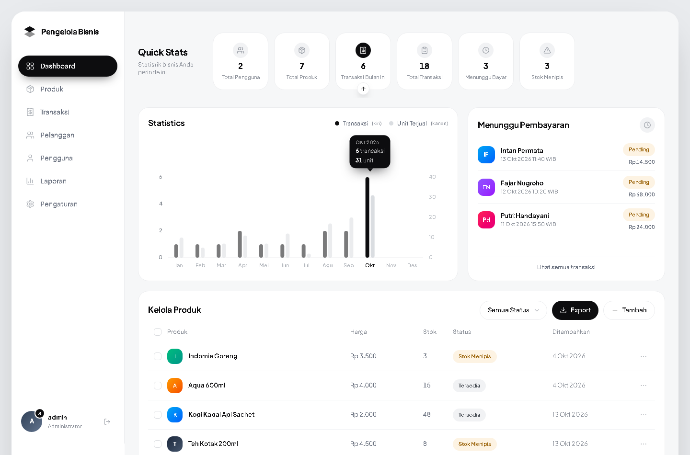

# App Pengelola Bisnis

Aplikasi pengelola bisnis: manajemen produk, transaksi penjualan, dan laporan
dalam satu dashboard — dibangun dengan React di sisi depan dan Express + MySQL
di sisi belakang.



---

## Fitur

- **Dashboard** — enam kartu statistik, grafik batang transaksi vs unit terjual
  per bulan (dua sumbu Y), dan panel transaksi yang menunggu pembayaran.
- **Produk** — tambah, ubah, hapus (soft delete), cari, filter status,
  paginasi, dan export CSV.
- **Transaksi (layar kasir)** — mencatat penjualan: pilih produk, atur jumlah,
  isi nama pembeli, pilih metode bayar. Item otomatis masuk ke
  `detail_transaksi` dengan `transaksi_id` transaksi barunya, dan stok
  berkurang. Bisa dibuka langsung lewat tautan `#/transaksi?baru=1`.
- **Riwayat transaksi** — daftar dengan filter status + pencarian, dan modal
  rincian item per transaksi.
- **Batalkan transaksi** — salah input bisa dibatalkan: status jadi
  `CANCELLED` dan stok produk dikembalikan. Barisnya tidak dihapus sehingga
  riwayat penjualan tetap bisa ditelusuri.
- **Pelanggan** — ringkasan belanja per pembeli, disusun dari riwayat transaksi.
- **Pengguna** — daftar akun beserta perannya (khusus admin).
- **Laporan** — rekap pendapatan, transaksi, dan unit terjual per bulan.
- **Autentikasi JWT** — login, token di header `Authorization`, auto-logout
  saat token kedaluwarsa.
- **Hak akses** — admin bisa menulis, kasir hanya bisa membaca.

---

## Teknologi

| Bagian | Dipakai |
|---|---|
| Frontend | React 19, Vite 8, Tailwind CSS 4, React Router 7 |
| Backend | Node.js, Express 5, mysql2, bcrypt, jsonwebtoken |
| Database | MySQL (InnoDB, utf8mb4) |
| Deploy | GitHub Pages (frontend) + Render (backend) + MySQL cloud |

Grafik dan seluruh ikon digambar sendiri sebagai SVG — tanpa pustaka grafik
maupun pustaka ikon.

---

## Struktur folder

```
.
├── Backend/            API Express
│   ├── config/         koneksi database (mendukung TLS)
│   ├── controllers/    logika tiap endpoint
│   ├── middleware/     auth JWT, hak akses, CORS, error handler
│   ├── models/         query SQL
│   ├── routes/         definisi endpoint
│   ├── dbSetup.js      menyiapkan tabel di database mana pun
│   └── seedDemo.js     data contoh (id 900+, mudah dihapus)
├── Frontend/           aplikasi React
│   ├── src/
│   └── docs/           tangkapan layar
├── database/           schema.sql, seed.sql, migrations
├── DEPLOY.md           panduan deploy langkah demi langkah
└── render.yaml         blueprint Render (opsional)
```

---

## Menjalankan di komputer sendiri

### Cara cepat (Windows)

Klik dua kali **`jalankan.bat`**. Skrip itu akan:

1. memeriksa Node.js, MySQL, dan berkas konfigurasi
2. memasang dependensi kalau belum ada
3. menjalankan backend dan frontend di dua jendela terpisah
4. membuka browser ke <http://localhost:5173>

Aman dijalankan berulang — kalau backend atau frontend sudah jalan, bagian itu
dilewati, jadi tidak akan muncul error "port sudah dipakai".

**Syaratnya MySQL harus sudah menyala** (XAMPP / Laragon / layanan MySQL
Windows). Skrip akan berhenti dengan pesan jelas kalau MySQL belum aktif.

Untuk menghentikan aplikasi: tutup dua jendela `cmd` yang terbuka.

### Cara manual

Butuh **dua terminal**.

### 1. Database

Ikuti `database/README.md` — jalankan `schema.sql` lalu `seed.sql`
(bisa lewat phpMyAdmin atau lewat `npm run db:setup`).

### 2. Backend

```bash
cd Backend
cp .env.example .env      # lalu isi DB_USER / DB_PASSWORD / JWT_SECRET
npm install
npm start                 # http://localhost:3000
```

### 3. Frontend

```bash
cd Frontend
npm install
npm run dev               # http://localhost:5173
```

Buka <http://localhost:5173>.

> Saat development tidak perlu mengatur CORS: dev server Vite mem-proxy
> `/api` ke `localhost:3000`, sehingga browser melihat satu origin saja.

### Akun bawaan

| Nama | Password | Peran |
|---|---|---|
| admin | admin123 | Administrator |
| budi | budi123 | Kasir |

⚠️ **Ganti password ini sebelum dipublikasikan.** Kalau situsnya online, siapa
pun yang membaca README ini bisa masuk sebagai admin.

```bash
cd Backend
npm run user:password -- admin "PasswordBaruYangPanjang"
```

---

## Endpoint API

Semua endpoint kecuali login butuh header `Authorization: Bearer <token>`.

| Metode | Endpoint | Akses | Keterangan |
|---|---|---|---|
| POST | `/api/auth/login` | publik | Masuk, mengembalikan token JWT |
| GET | `/api/dashboard/ringkasan` | admin, kasir | Statistik + grafik 12 bulan + transaksi pending |
| GET | `/api/produk` | admin, kasir | Daftar produk (`?cari=`, `?status=`, `?limit=`, `?offset=`) |
| GET | `/api/produk/:id` | admin, kasir | Satu produk |
| POST | `/api/produk` | admin | Tambah produk |
| PUT | `/api/produk/:id` | admin | Ubah produk |
| DELETE | `/api/produk/:id` | admin | Soft delete (`is_active = 0`) |
| GET | `/api/transaksi` | admin, kasir | Daftar transaksi (`?cari=`, `?status=`, paginasi) |
| POST | `/api/transaksi` | admin, kasir | Buat transaksi (stok berkurang otomatis, dalam satu transaksi database) |
| GET | `/api/transaksi/:id` | admin, kasir | Header + rincian item |
| PATCH | `/api/transaksi/:id/batal` | admin, kasir | Batalkan transaksi + kembalikan stok |
| GET | `/api/users` | admin | Daftar pengguna (tanpa kolom password) |

---

## Data contoh (opsional)

```bash
cd Backend
npm run demo:pasang    # 5 produk + 16 transaksi demo
npm run demo:hapus     # hapus semuanya lagi
```

Data demo memakai **id 900–999** dan kode transaksi berawalan `DEMO-`, jadi
data asli Anda tidak pernah tersentuh.

---

## Deploy ke internet

Panduan lengkap ada di **[DEPLOY.md](DEPLOY.md)**. Ringkasnya:

1. **MySQL cloud** — Aiven / TiDB Cloud / Railway
2. **Backend ke Render** — root directory `Backend`, start command `npm start`
3. **Isi tabel** — `cd Backend && npm run db:setup` dengan `.env` menunjuk ke cloud
4. **Repository variable** `VITE_API_BASE` = `https://<backend>.onrender.com/api`
5. **GitHub Pages** — Settings → Pages → Source: **GitHub Actions**

Setelah itu setiap `git push` ke folder `Frontend/` otomatis memperbarui situs.

---

## Catatan desain

- Antarmuka mengikuti desain dashboard Jobbio, dengan istilah disesuaikan ke
  domain aplikasi ini (produk, transaksi, pengguna).
- Animasi sengaja minimalis: kartu muncul berjenjang, batang grafik tumbuh,
  tooltip dan modal muncul singkat. Semuanya mati otomatis bila pengguna
  mengaktifkan *prefers-reduced-motion*.
- Grafik memakai **dua sumbu Y** karena jumlah transaksi (1–6 per bulan) dan
  unit terjual (10–31 per bulan) berbeda skala sekitar lima kali. Kalau dipaksa
  satu sumbu, batang transaksi jadi hampir tak terlihat.
